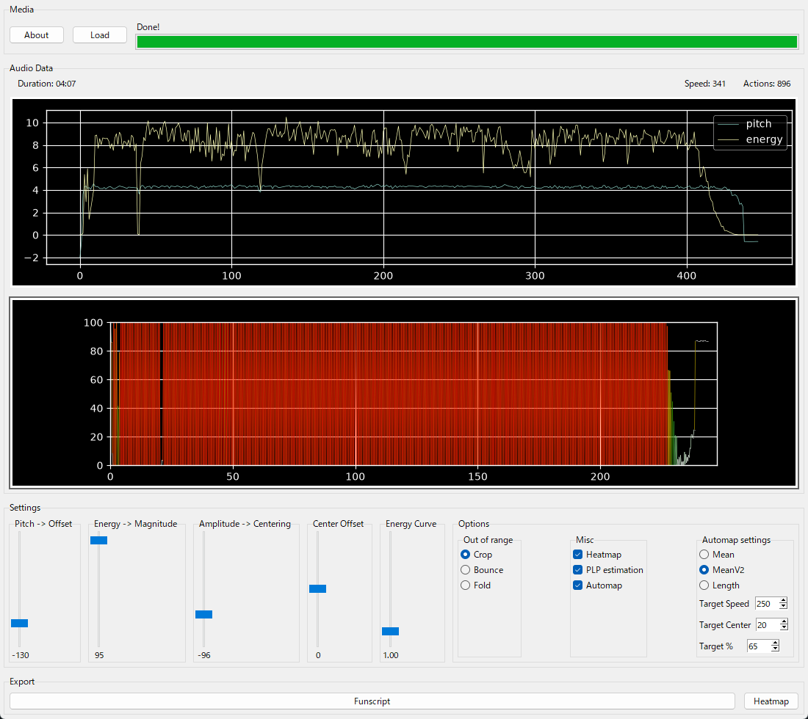

**English** | [日本語](README.ja.md)

https://github.com/ncdxncdx/FunscriptDancer の Python への移植です。



## 動作要件

- Python 3.11 以上（3.14 で動作確認済み）
- `PATH` に登録した [ffmpeg](https://ffmpeg.org/download.html)。`-c/--convert` で使用されるほか、直接読み込めない音声形式（例: `.m4a`）の場合は自動的にフォールバックとして使われます。

## インストールと実行

```
git clone https://github.com/electrist9/PythonDancerEct9.git
cd PythonDancerEct9
pip install -r requirements.txt
```

GUI:

```
python ui_entry.py
```

CLI（`dancer` パッケージをインポートできるよう、リポジトリの直下で実行してください）:

```
python -m dancer.cli -h
python -m dancer.cli input.wav -m -y
```

> `dancer` はパッケージとしてインストールされません。リポジトリの直下で実行するか、ルートを `PYTHONPATH` に追加してください。

## CLI

以下は実際の出力です（プログラム自体は英語で表示します）。

```
usage: libfun [-h] [--out_path OUT_PATH] [--csv] [-m] [-c] [-a] [-y]
              [--no_plp] [--cli] [--auto_pitch [0-100]] [--auto_speed [0-400]]
              [--auto_per [0-100]] [--auto_mod [1-3]] [--pitch [-200-200]]
              [--energy [0-100]] [--amplitude_centering [-100-100]]
              [--overflow [0-2]] [--center_offset [-100-100]]
              [--energy_curve [0-10]]
              [audio_path]

Creates funscripts from audio

positional arguments:
  audio_path            Path to input media (default: None)

options:
  -h, --help            show this help message and exit
  --out_path OUT_PATH   Path to export funscript (default: None)
  --csv                 Export as CSV instead of funscript (default: False)
  -m, --heatmap         Export heatmap (default: False)
  -c, --convert         Automatically use ffmpeg to convert input media
                        (default: False)
  -a, --automap         Automatically find suitable pitch and energy values
                        (default: False)
  -y, --yes             Overwrite funscript (default: False)
  --no_plp              Disable PLP (default: False)
  --cli                 Use commandline (default: False)
  --auto_pitch [0-100]  Where you want the actions to generally lie in percent
                        (default: 20)
  --auto_speed [0-400]  The target action speed in units/s (default: 250)
  --auto_per [0-100]    The target percent of actions that should have a speed
                        above the specified speed (default: 65)
  --auto_mod [1-3]      Which optimizer to use (cmean, cmeanv2, clen)
                        (default: 2)
  --pitch [-200-200]    The pitch (default: 100)
  --energy [0-100]      The energy magnitude (default: 10.0)
  --amplitude_centering [-100-100]
                        Amplitude-based centering shift (default: 0)
  --overflow [0-2]      Overflow type (default: 0)
  --center_offset [-100-100]
                        Center offset shift (default: 0)
  --energy_curve [0-10]
                        Power applied to normalized energy (>1 widens
                        dynamics) (default: 1.0)
```

### オプション（日本語解説）

- `audio_path`: 入力メディアのパス。
- `--out_path`: 出力する funscript のパス。
- `--csv`: funscript ではなく CSV で出力する。
- `-m, --heatmap`: ヒートマップを出力する。
- `-c, --convert`: ffmpeg で入力メディアを自動変換する。
- `-a, --automap`: 適切な pitch と energy の値を自動探索する。
- `-y, --yes`: 既存の funscript を上書きする。
- `--no_plp`: PLP を無効化する。
- `--cli`: コマンドラインモードで使う。
- `--auto_pitch`: 動作が概ねどのパーセント位置に来るようにするか。
- `--auto_speed`: 目標とする動作速度（units/s）。
- `--auto_per`: 指定速度を超える動作の割合（パーセント）の目標値。
- `--auto_mod`: 使用するオプティマイザ（cmean, cmeanv2, clen）。
- `--pitch`: ピッチ。
- `--energy`: エネルギーの大きさ（float で指定可）。
- `--amplitude_centering`: 振幅に基づく中心シフト。
- `--overflow`: オーバーフローの種類。
- `--center_offset`: 中心オフセットのシフト。
- `--energy_curve`: 正規化済みエネルギーに加えるべき乗。1 より大きいと強弱が広がります。

### ヒント

- `--energy_curve`（既定 `1.0`）は正規化済みエネルギーにべき乗を適用します。`1` より大きいほど動作の強弱（緩急）のコントラストが強くなります。`1.5`〜`3.0` をお試しください。
- `-m/--heatmap` は funscript と同じ場所に `<output>_heatmap.png` を出力します。
- ヒートマップの色は動作速度を表します。赤が速い、緑が中程度、青が遅い動作です。
