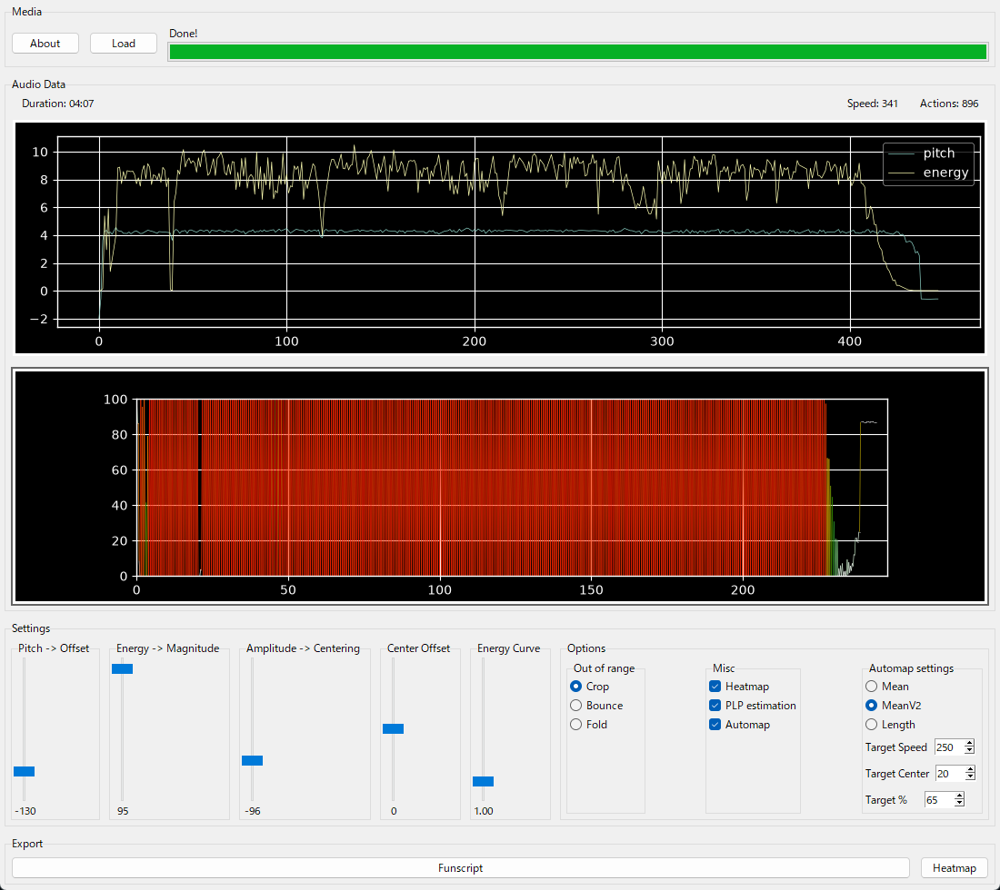

**English** | [日本語](README.ja.md)

A port of https://github.com/ncdxncdx/FunscriptDancer to python



## Quick start

**No Python installed?** Download the pre-built Windows executables from the [latest release](https://github.com/electrist9/PythonDancerEct9/releases/latest) and run them directly. They are self-contained and need no Python installation:

- `PythonDancer-GUI.exe` — double-click to open the graphical interface.
- `PythonDancer-CLI.exe` — run from a terminal, for example `PythonDancer-CLI.exe input.wav -m -y`.

> ffmpeg is still required on your `PATH` for `-c/--convert` and for reading formats such as `.m4a` (see [Requirements](#requirements)).

**Have Python and want to run from source?** See [Install & run](#install--run) below.

## Requirements

These apply when running from source. The pre-built executables need no Python installation (only ffmpeg, as noted above).

- Python 3.11 or newer (tested on 3.14)
- [ffmpeg](https://ffmpeg.org/download.html) on your `PATH`. It is used by `-c/--convert` and as an automatic fallback when an audio file cannot be read directly (for example `.m4a`).

## Install & run

```
git clone https://github.com/electrist9/PythonDancerEct9.git
cd PythonDancerEct9
pip install -r requirements.txt
```

GUI:

```
python ui_entry.py
```

CLI (run from the repository root so the `dancer` package is importable):

```
python -m dancer.cli -h
python -m dancer.cli input.wav -m -y
```

> `dancer` is not installed as a package, so run the commands from the repository root, or add the root to `PYTHONPATH`.

## Build standalone executables

Single-file Windows executables can be built with [PyInstaller](https://pyinstaller.org/) (already listed in `requirements.txt`). Run these from the repository root:

```
pyinstaller gui.spec   # -> dist/PythonDancer-GUI.exe  (graphical interface)
pyinstaller cli.spec   # -> dist/PythonDancer-CLI.exe  (command-line interface)
```

Each executable is a self-contained `--onefile` bundle (about 150 MB) that includes Python, NumPy, SciPy, librosa, numba, soundfile and matplotlib, so no Python installation is needed to run it. The first launch is slower because the bundle unpacks itself to a temporary folder.

> ffmpeg is **not** bundled. The executables still require ffmpeg on your `PATH` for `-c/--convert` and for the automatic fallback on formats such as `.m4a`.

## CLI

```
usage: libfun [-h] [--out_path OUT_PATH] [--csv] [-m] [-c] [-a] [-y]
              [--no_plp] [--cli] [--auto_pitch [0-100]] [--auto_speed [0-400]]
              [--auto_per [0-100]] [--auto_mod [1-3]] [--pitch [-200-200]]
              [--energy [0-100]] [--amplitude_centering [-100-100]]
              [--overflow [0-2]] [--center_offset [-100-100]]
              [--energy_curve [0-10]]
              [audio_path]

Creates funscripts from audio

positional arguments:
  audio_path            Path to input media (default: None)

options:
  -h, --help            show this help message and exit
  --out_path OUT_PATH   Path to export funscript (default: None)
  --csv                 Export as CSV instead of funscript (default: False)
  -m, --heatmap         Export heatmap (default: False)
  -c, --convert         Automatically use ffmpeg to convert input media
                        (default: False)
  -a, --automap         Automatically find suitable pitch and energy values
                        (default: False)
  -y, --yes             Overwrite funscript (default: False)
  --no_plp              Disable PLP (default: False)
  --cli                 Use commandline (default: False)
  --auto_pitch [0-100]  Where you want the actions to generally lie in percent
                        (default: 20)
  --auto_speed [0-400]  The target action speed in units/s (default: 250)
  --auto_per [0-100]    The target percent of actions that should have a speed
                        above the specified speed (default: 65)
  --auto_mod [1-3]      Which optimizer to use (cmean, cmeanv2, clen)
                        (default: 2)
  --pitch [-200-200]    The pitch (default: 100)
  --energy [0-100]      The energy magnitude (default: 10.0)
  --amplitude_centering [-100-100]
                        Amplitude-based centering shift (default: 0)
  --overflow [0-2]      Overflow type (default: 0)
  --center_offset [-100-100]
                        Center offset shift (default: 0)
  --energy_curve [0-10]
                        Power applied to normalized energy (>1 widens
                        dynamics) (default: 1.0)
```

### Tips

- `--energy_curve` (default `1.0`) applies a power curve to the normalized energy. Values above `1` widen the dynamic range, giving a stronger contrast between fast and slow strokes. Try `1.5`–`3.0`.
- `-m/--heatmap` writes `<output>_heatmap.png` next to the funscript.
- The heatmap colour encodes stroke speed: red is fast, green is medium, blue is slow.
